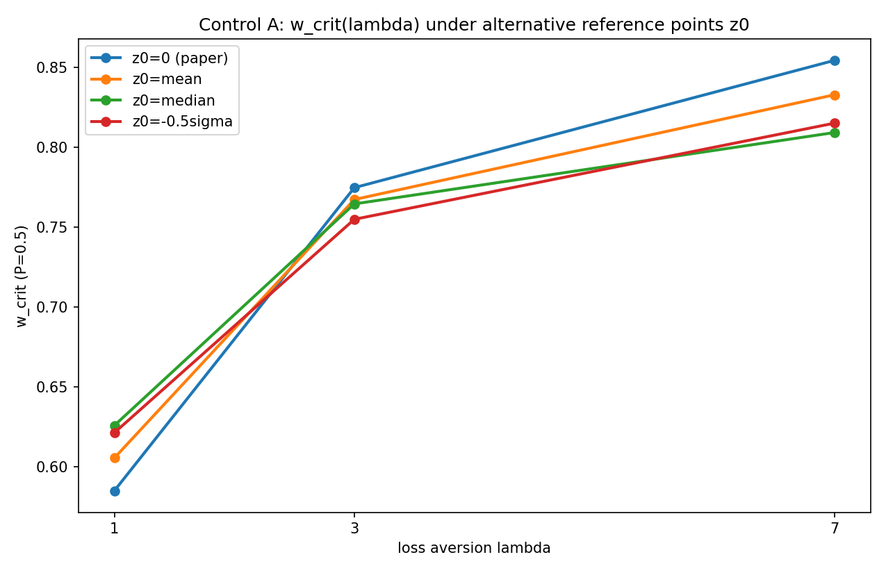

# Control A -- reference-point robustness of the lambda=1->7 w_crit shift

1200 runs. Estimator: Firth penalized logistic. Seed-paired bootstrap n=2000 (shared 20 seeds).

**VERDICT: ROBUST: the lambda=1->7 shift survives in EVERY reference-point arm -> the loss-asymmetry interpretation holds independent of z0.**

| reference point | z0 | w_crit(1) | w_crit(3) | w_crit(7) | shift 1->7 | 95% CI | n |
|---|---|---|---|---|---|---|---|
| z0=0 (paper) | 0.000 | 0.585 | 0.775 | 0.854 | +0.269 | [+0.232, +0.306] | 300 |
| z0=mean | -2.990 | 0.605 | 0.767 | 0.833 | +0.228 | [+0.187, +0.272] | 300 |
| z0=median | -6.765 | 0.626 | 0.764 | 0.809 | +0.183 | [+0.122, +0.269] | 300 |
| z0=-0.5sigma | -5.137 | 0.621 | 0.755 | 0.815 | +0.193 | [+0.141, +0.247] | 300 |

## Free diagnostics per arm (mean over cells)

### z0=0 (paper) (z0=0.000)
```
             frac_loss  mean_cpt_reward  reward_std  return_std
lambda_loss                                                    
1                0.293            4.526       8.611      11.999
3                0.493           -5.932       9.100       6.316
7                0.579          -25.804       9.628       2.521
```
### z0=mean (z0=-2.990)
```
             frac_loss  mean_cpt_reward  reward_std  return_std
lambda_loss                                                    
1                0.336            5.005       9.113      23.355
3                0.415           -0.460       8.575       6.748
7                0.522          -15.805       9.498       8.916
```
### z0=median (z0=-6.765)
```
             frac_loss  mean_cpt_reward  reward_std  return_std
lambda_loss                                                    
1                0.326            6.720       9.253      14.376
3                0.365            4.300       8.871      10.689
7                0.434           -2.883       9.353       7.383
```
### z0=-0.5sigma (z0=-5.137)
```
             frac_loss  mean_cpt_reward  reward_std  return_std
lambda_loss                                                    
1                0.337            6.364       8.952      15.450
3                0.418            1.982       8.986      11.240
7                0.500           -8.326       9.357       8.209
```


