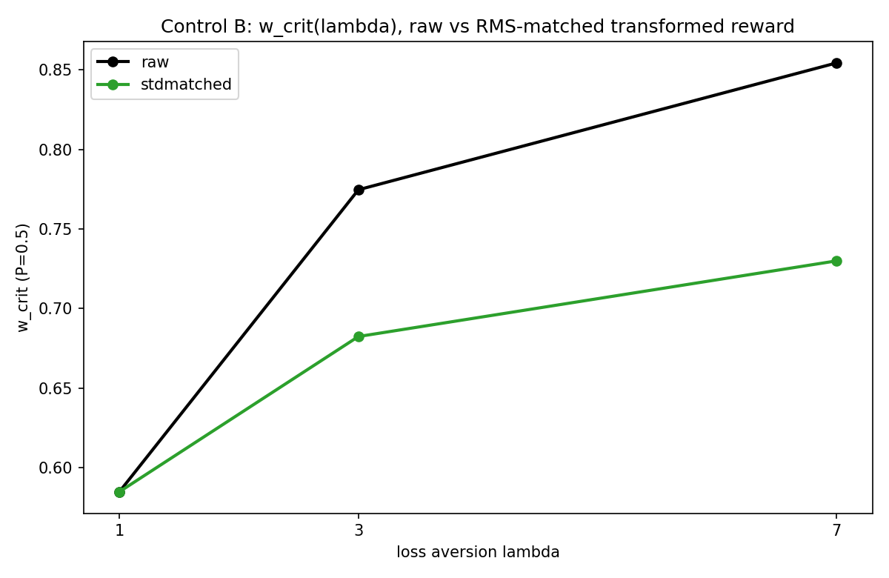

# Control B -- scale-matched control (is lambda just amplification?)

600 runs. Firth penalized logistic; seed-paired bootstrap n=2000.

**VERDICT: NOT amplification: the lambda=1->7 shift SURVIVES RMS-matching (stdmatched shift +0.145 [+0.106, +0.185], CI excludes 0). The loss asymmetry, not reward magnitude, drives w_crit.**

| arm | w_crit(1) | w_crit(3) | w_crit(7) | shift 1->7 | 95% CI | n |
|---|---|---|---|---|---|---|
| raw | 0.585 | 0.775 | 0.854 | +0.269 | [+0.232, +0.306] | 300 |
| stdmatched | 0.585 | 0.682 | 0.730 | +0.145 | [+0.106, +0.185] | 300 |

## Reward-side confounds per lambda (variance, sign fractions, return variance)

### Control B (raw arm)
```
                reward_std  reward_var  frac_gain  frac_loss  return_std  mean_cpt_reward
lambda (B-raw)                                                                           
1                    8.611      74.154      0.707      0.293      11.999            4.526
3                    9.100      82.802      0.507      0.493       6.316           -5.932
7                    9.628      92.700      0.421      0.579       2.521          -25.804
```
### Control A
```
                    reward_std  reward_var  frac_gain  frac_loss  return_std  mean_cpt_reward
lambda (Control A)                                                                           
1                        8.982      80.679      0.677      0.323      16.295            5.654
3                        8.883      78.904      0.577      0.423       8.748           -0.028
7                        9.459      89.475      0.491      0.509       6.757          -13.205
```
### Control C
```
                    reward_std  reward_var  frac_gain  frac_loss  return_std  mean_cpt_reward
lambda (Control C)                                                                           
1                       11.524     132.799      0.651      0.349      13.093            4.542
3                       12.204     148.945      0.497      0.503       4.873           -7.624
7                       13.124     172.250      0.418      0.582       5.448          -33.111
```


