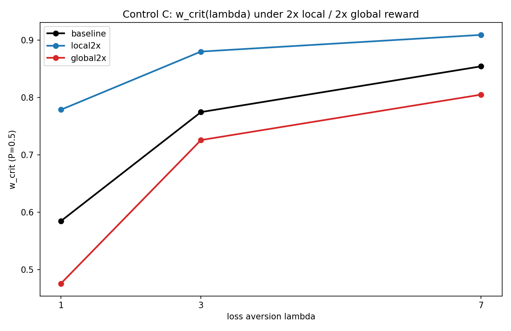

# Control C -- reward-unit sensitivity of w_crit

900 runs. Firth penalized logistic; seed-paired bootstrap n=2000.

**VERDICT: EXPECTED: numerical w_crit MOVES under reward reparameterization (so w is a nominal mixture coefficient, not scale-free), BUT the lambda=1->7 loss-aversion shift PERSISTS within every arm. Report the normalized incentive ratio alongside w.**

| arm | (c_local,c_global) | w_crit(1) | w_crit(3) | w_crit(7) | shift 1->7 | CI | ratio@wc(1) | n |
|---|---|---|---|---|---|---|---|---|
| baseline | (1,1) | 0.585 | 0.775 | 0.854 | +0.269 | [+0.232, +0.306] | 0.710 | 300 |
| local2x | (2,1) | 0.779 | 0.880 | 0.909 | +0.130 | [+0.105, +0.153] | 0.568 | 300 |
| global2x | (1,2) | 0.476 | 0.726 | 0.805 | +0.329 | [+0.263, +0.430] | 0.550 | 300 |

The normalized local-to-global incentive ratio  (1-w)*c_local / (w*c_global)  is the scale-invariant quantity to report alongside the nominal w.

