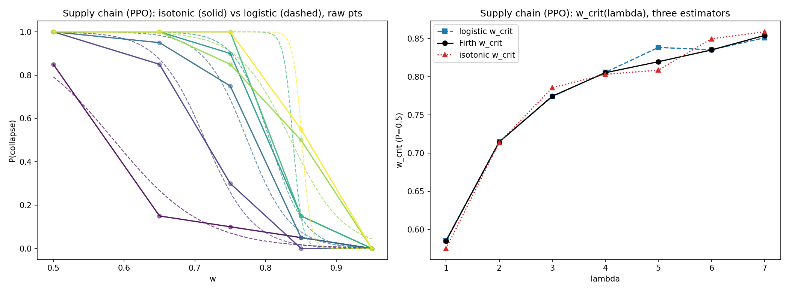
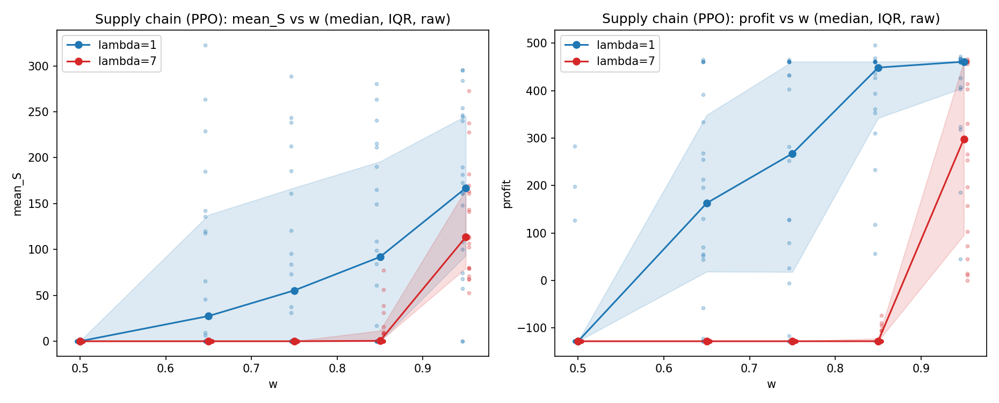
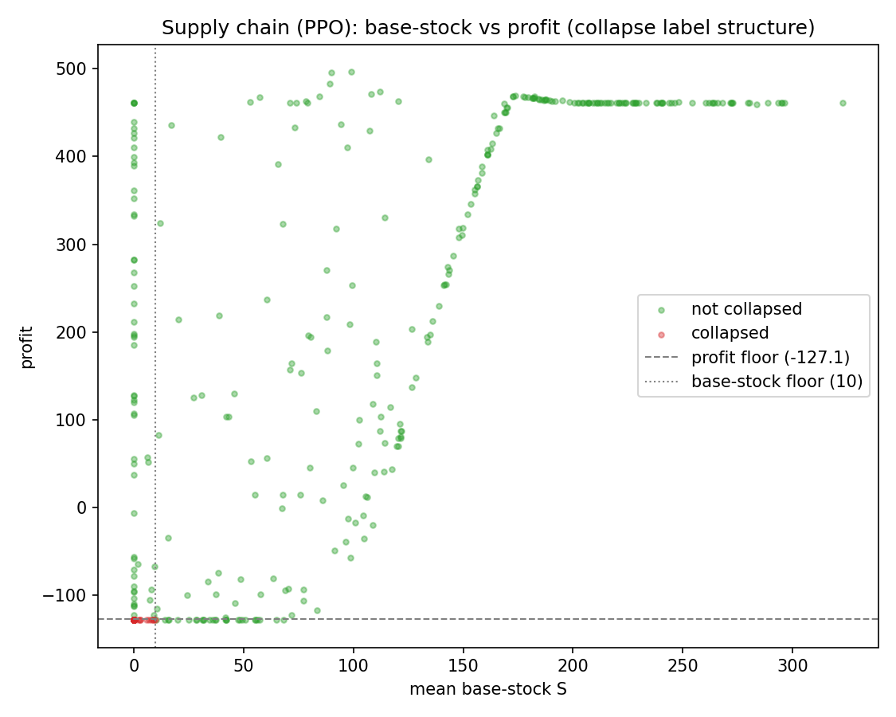

# Part-2 reanalysis -- robustness of the lambda=1->7 rightward w_crit shift

No new training. Reanalysis of existing raw-data CSVs.

## Method

- Bootstrap replicates: **2000**.
- Resampling unit: **seed (seed-blocked / paired: one seed index resampled across all lambda per replicate)**.
- Separation handling: Firth penalized logistic (Jeffreys-prior) for separated/steep cells; logistic MLE falls back to L2-regularized fit on non-finite SE; isotonic is separation-free by construction. Bootstrap replicates whose resample is degenerate (collapsed constant or <2 distinct w) are skipped and the count of usable replicates is reported.
- Difference CI: Difference w_crit(lambda=1) - w_crit(lambda=7) recomputed within each paired bootstrap replicate (same resampled seeds used for both lambda), 2.5/97.5 percentiles of the replicate differences.
- Estimators: logistic (statsmodels, L2 fallback), Firth penalized logistic, and isotonic regression (monotone-decreasing in w).
- w_crit: logistic/Firth = -b0/b1; isotonic = interpolated grid crossing of P(collapse)=0.5 (NaN if the monotone curve never crosses within the w-grid).

## Supply chain (PPO)  (lambda in [1, 2, 3, 4, 5, 6, 7])

### w_crit(lambda), three estimators
| lambda | logistic | Firth | isotonic | in-grid? | n |
|---|---|---|---|---|---|
| 1 | 0.586 | 0.585 | 0.575 | yes | 100 |
| 2 | 0.715 | 0.714 | 0.714 | yes | 100 |
| 3 | 0.774 | 0.775 | 0.786 | yes | 100 |
| 4 | 0.806 | 0.805 | 0.803 | yes | 100 |
| 5 | 0.839 | 0.820 | 0.809 | yes | 100 |
| 6 | 0.836 | 0.835 | 0.850 | yes | 100 |
| 7 | 0.851 | 0.854 | 0.859 | yes | 100 |

- **logistic shift lambda=1->7: +0.266** (0.586 -> 0.851)
- **firth shift lambda=1->7: +0.269** (0.585 -> 0.854)
- **isotonic shift lambda=1->7: +0.284** (0.575 -> 0.859)

### Seed-paired bootstrap (Firth w_crit, 2000/2000 usable replicates)
- w_crit(lambda=1) = 0.585 [0.545, 0.626]
- w_crit(lambda=7) = 0.854 [0.837, 0.871]
- **difference (lambda=7 - lambda=1) = 0.269 [0.232, 0.306]** (paired; CI excludes 0 => shift is seed-robust)

### Raw collapse counts k/n at every w
Collapse fraction:
```
w    0.50  0.65  0.75  0.85  0.95
lam                              
1    0.85  0.15  0.10  0.05   0.0
2    1.00  0.85  0.30  0.00   0.0
3    1.00  0.95  0.75  0.05   0.0
4    1.00  1.00  0.90  0.15   0.0
5    1.00  1.00  1.00  0.15   0.0
6    1.00  1.00  0.85  0.50   0.0
7    1.00  1.00  1.00  0.55   0.0
```
Raw counts (k collapsed / n):
```
w         0.50       0.65       0.75       0.85      0.95
lam                                                      
1    17.0/20.0   3.0/20.0   2.0/20.0   1.0/20.0  0.0/20.0
2    20.0/20.0  17.0/20.0   6.0/20.0   0.0/20.0  0.0/20.0
3    20.0/20.0  19.0/20.0  15.0/20.0   1.0/20.0  0.0/20.0
4    20.0/20.0  20.0/20.0  18.0/20.0   3.0/20.0  0.0/20.0
5    20.0/20.0  20.0/20.0  20.0/20.0   3.0/20.0  0.0/20.0
6    20.0/20.0  20.0/20.0  17.0/20.0  10.0/20.0  0.0/20.0
7    20.0/20.0  20.0/20.0  20.0/20.0  11.0/20.0  0.0/20.0
```







### Nature of the object
See the continuous-metric plot: if the per-w distributions are smooth rather than bimodal, describe the boundary as a **threshold-defined behavioral crossing**, not a physical phase transition.

